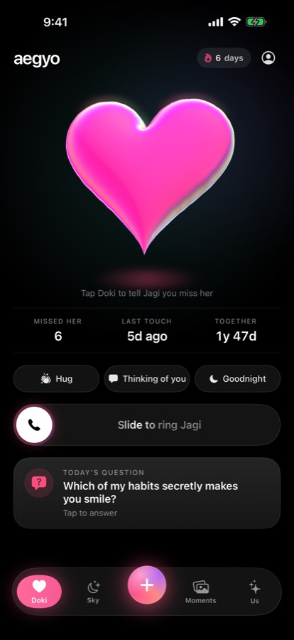
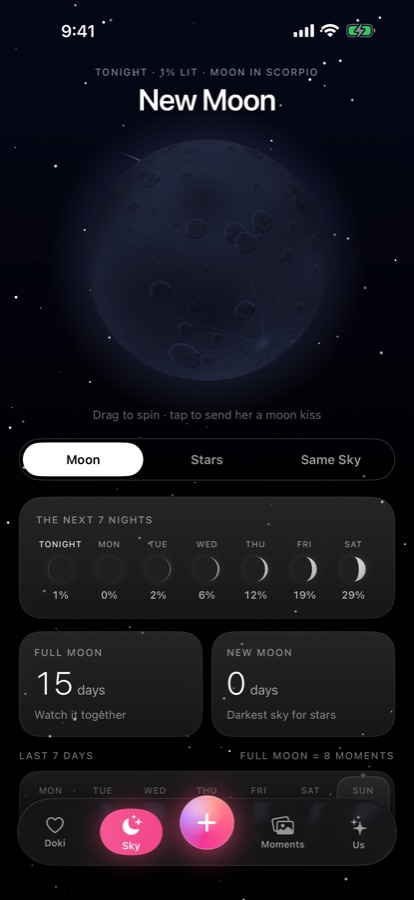
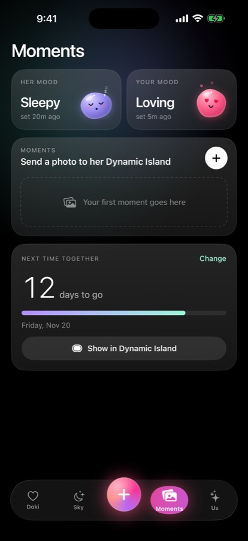
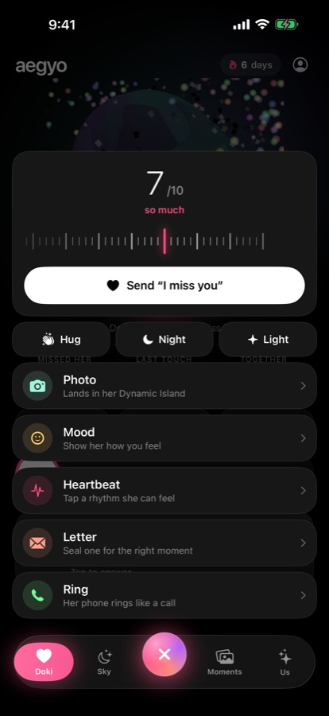
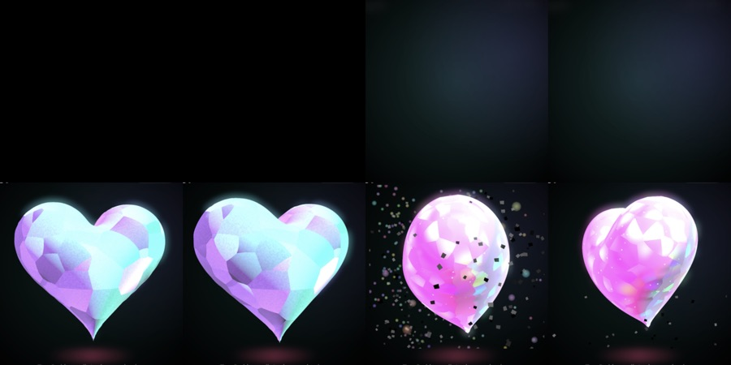
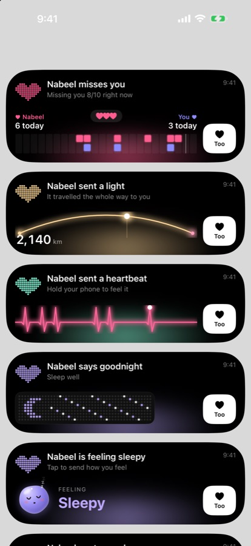
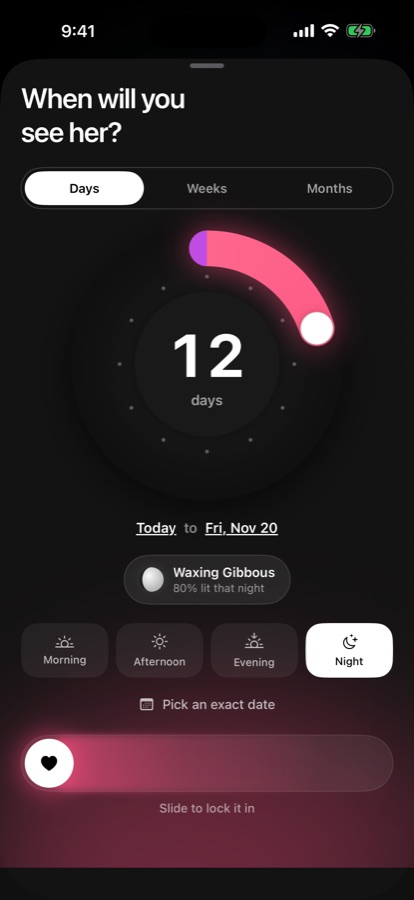
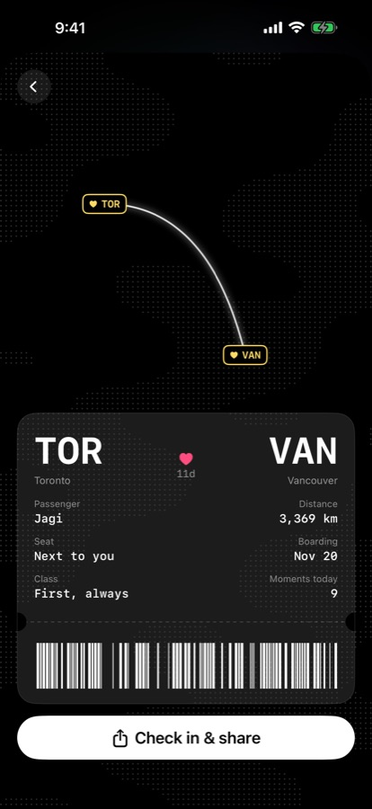
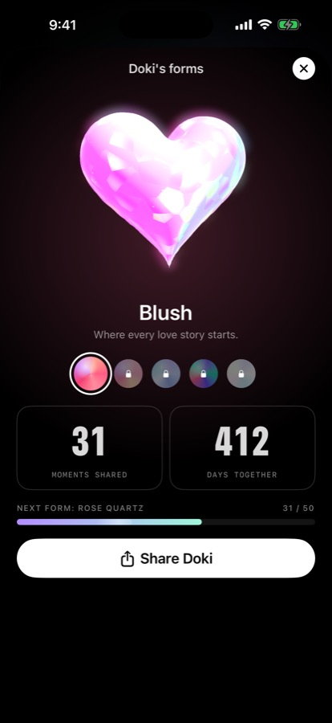
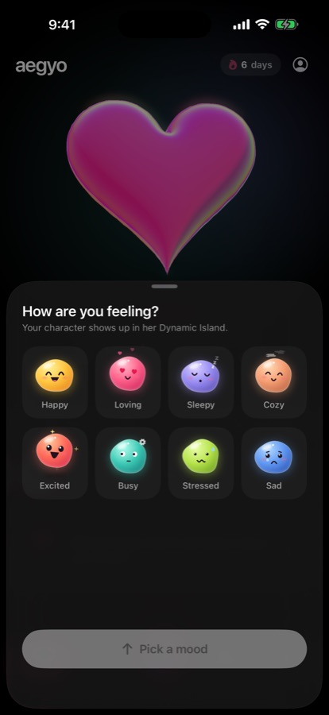

# Aegyo

A private iOS app for two people in a long-distance relationship. Tap the heart and it shows up in your partner's Dynamic Island. Ring their phone with a singing-bowl ringtone. Share moods, photos, letters and heartbeats, and count down to the next time you meet.

Built with SwiftUI, SceneKit, ActivityKit and Metal for iPhone (iOS 18+, Dynamic Island devices).

<p align="center">
  
  
  
  
</p>

## Highlights

**Doki, a 3D opal heart.** A procedurally generated heart mesh (the classic heart curve inflated by solving a pressurised-membrane Poisson equation with SOR, so it has no creases) rendered in SceneKit. Custom Metal shader modifiers give it opal "play of colour" (3D Voronoi cells whose hue shifts with view angle), a fresnel rainbow rim, twinkling glints and a moving specular highlight. It beats with a lub-dub rhythm that speeds up when tapped, tilts with the gyroscope, and spins with inertia. On launch it starts as a faceted stone heart whose seams glow, then shatters into particles to reveal the opal.

<p align="center"></p>

**Dynamic Island first.** Every interaction is delivered as a Live Activity, not a notification. Each kind of message has its own expanded-island design:
- a "you vs her today" duet timeline
- a neon arc showing the distance between you
- a neon ECG drawn from the tapped heartbeat rhythm
- the animated mood character
- dot-matrix LED pixel scenes

Notifications are reserved for reminders, such as a daily nudge that cancels itself once you've sent love that day.

<p align="center"></p>

**Motion and feel.**
- A liquid-glass tab bar where a metaball blob (two springs merged with an alpha-threshold Canvas filter) stretches between tabs.
- A Metal water-ripple shader across the background when the heart is tapped, with a whole-screen shake.
- Haptics on every touch, plus Core Haptics patterns for heartbeats and holds.
- Custom controls built from reference interactions: hold-to-send where two avatars converge, slide-to-confirm with a flooding fill, a merge button bar, a ruler slider, a tick scrubber, and a rotary date dial.

<p align="center">
  
  
  
  
</p>

**Sky.**
- A 3D moon with a procedurally generated crater texture, lit by the real moon phase for any night you scrub to.
- Each partner's zodiac sign as an animated constellation, plus compatibility and a daily love forecast.
- "Same Sky": live sky colours for each partner's local time, the distance between you, and a travelling-light animation.

**Sound.** The chime, ringtone and send sound are synthesized in Python with NumPy and SciPy. The technique is modal synthesis of a crystal singing bowl, using detuned partial pairs for the beating, felt-mallet attacks and a stereo convolution reverb (`tools/make_sounds.py`).

**Also included:**
- Call-style ringing via CallKit and PushKit
- Photos sent to the Dynamic Island
- "Open When" letters with an envelope animation
- A daily question
- A heartbeat tap-code
- Shareable story cards (Love Wrapped, Love Pass, milestones, love-language quiz)
- Home and Lock Screen widgets
- Siri and Action Button shortcuts (App Intents)

## Tech

| Area | Used |
|---|---|
| UI | SwiftUI, keyframe animators, `scrollTransition`, Liquid Glass (`glassEffect`) |
| 3D | SceneKit, procedural meshes, Metal shader modifiers, particle systems |
| GPU effects | SwiftUI Metal shaders (`layerEffect`) for the ripple |
| System | ActivityKit (Live Activities, Dynamic Island), WidgetKit, App Intents, CallKit, PushKit, UserNotifications, Core Haptics, Core Motion, Core Location (geocoding) |
| Audio | AVFoundation; sounds generated with NumPy/SciPy |
| Project | XcodeGen (`project.yml`) |

## Project layout

```
Aegyo/                 App target (SwiftUI)
  App/                 Entry point, push and VoIP registration
  Features/            Home, Sky, Moments, Root (tab bar, action stack), feature sheets
  Services/            LoveService (state and stats), Astro, Reminders, haptics, CallKit
AegyoWidgets/          Live Activities (Dynamic Island) and the Home Screen widget
AegyoShared/           Code shared with the widget: models, island art, mood characters
tools/                 Sound synthesis and icon generation scripts
docs/screenshots/      Images used in this README
project.yml            XcodeGen spec
```

## Running it

1. Install [XcodeGen](https://github.com/yonaskolb/XcodeGen) (`brew install xcodegen`) and Xcode 26 or later.
2. Generate the project:
   ```bash
   xcodegen generate
   ```
3. Open `Aegyo.xcodeproj`, set your Team under Signing & Capabilities for both targets, and run.

A free Apple account works for trying it out. Push notifications and the shared App Group (needed for photos inside the Dynamic Island) require a paid developer account.

## Status

The single-device experience is complete. Every interaction previews on the sender's phone exactly as the partner would see it. Next up is pairing two phones through a backend (Firebase Auth and Firestore, with Cloud Functions sending APNs Live Activity push-to-start and VoIP pushes).

## Author

Syed Nabeel Raza
